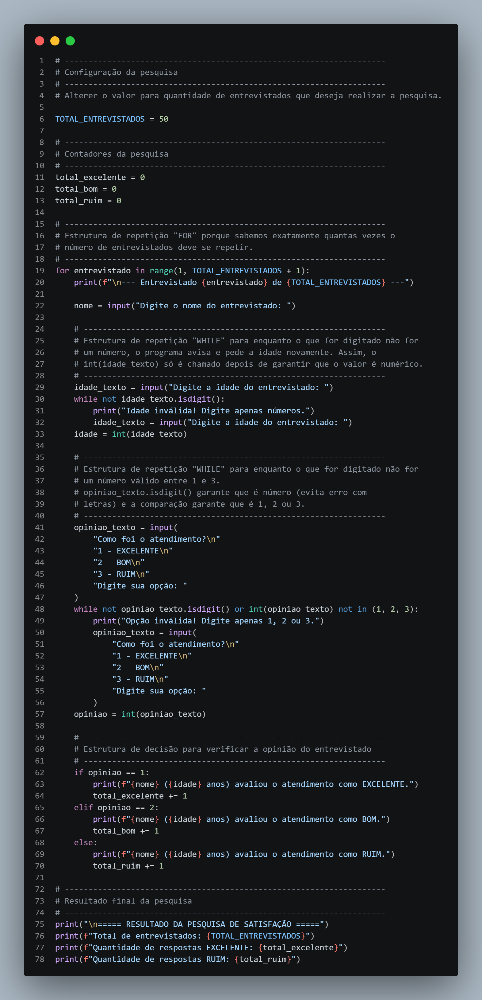
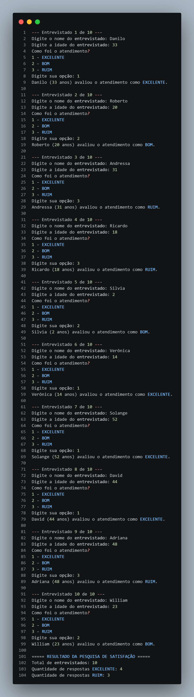

## 📋 Descrição

Programa realiza uma pesquisa de opinião com seus clientes para saber o grau de satisfação no atendimento.

O programa utiliza:

1. Utiliza estrutura de repetição para coletar e exibir o retorno de uma pesquisa de atendimento ao cliente.
2. Solicita **nome**, **idade** e **opinião** do entrevistado sobre o atendimento, sendo:
   - `1` → EXCELENTE
   - `2` → BOM
   - `3` → RUIM
3. Repete a coleta para **50 entrevistados**.
4. Ao final, exibe:
   - Quantidade de respostas **EXCELENTE**
   - Quantidade de respostas **RUIM**


## 🧠 Lógica utilizada

- **`for`**: como o número de entrevistados é conhecido antecipadamente (50), o laço percorre `range(1, total_entrevistados + 1)`.
- **`while`**: usado para **validar as entradas do usuário**, impedindo que o programa quebre ou aceite valores incorretos:
  - Repete a pergunta da **idade** enquanto o valor digitado não for numérico (`idade_texto.isdigit()`).
  - Repete a pergunta da **opinião** enquanto o valor digitado não for numérico **e** não estiver entre 1, 2 ou 3.
- **`if / elif / else`**: verifica a opinião já validada e incrementa o contador correspondente (`total_excelente`, `total_bom`, `total_ruim`).

Para facilitar os testes, a quantidade de entrevistados é controlada por uma única variável:

```python
total_entrevistados = 50 
```

## 💻 Código-fonte

Arquivo: [`app.py`](./app.py)



## ▶️ Execução do programa (teste com 10 entrevistados)

Teste realizado com `total_entrevistados = 10`



**Resultado do teste:**

| Total de entrevistados | EXCELENTE | RUIM |
|:-----------------------:|:---------:|:----:|
| 10 | 4 | 3 |


## 🎯 Competências trabalhadas

- Desenvolver raciocínio lógico utilizando estruturas de repetição.


